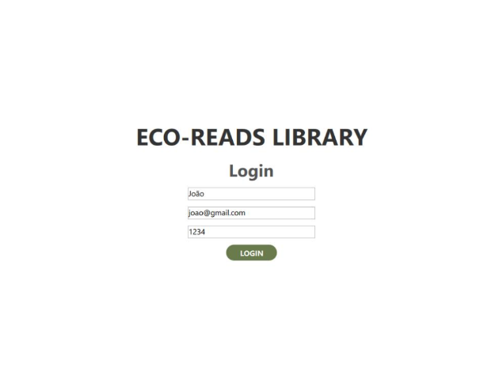
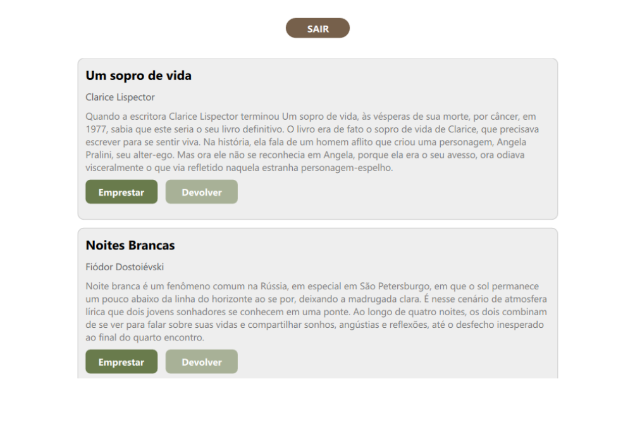

  
  # 📚 Eco-Reads Library
  
  

 

  
  

 

  

 

<table align="center" border="0" cellpadding="10" cellspacing="0">
  <tr>
    <td width="50%" align="center" valign="top">
      
O Eco-Reads Library é um projeto bem simples criado em C++ utilizando o Qt Creator. O principal objetivo foi colocar em prática os conhecimentos adquiridos durante a disciplina de Programação Orientada a Objetos.

    </td>
    <td width="50%" align="center" valign="top">
      
O sistema foi pensado para gerenciar uma biblioteca, em que os usuários realizam empréstimos e devoluções de livros, enquanto o bibliotecário cadastra e remove livros.

    </td>
  </tr>
</table>

 

 

 

- História da fotografia
- 15 fotografias históricas
- 5 fotógrafos famosos
- Tipos e estilos de fotografias
- Destaques de premiações, como o Sony World Photography Awards 2024
- Guia para iniciantes

 

- 🌗 Tema claro e escuro: pode alterar os modos de visualização
- 📝 Formulários: estruturalmente prontos em HTML
- 🖼️ Galeria de imagens: apresentação organizada das fotografias

 
